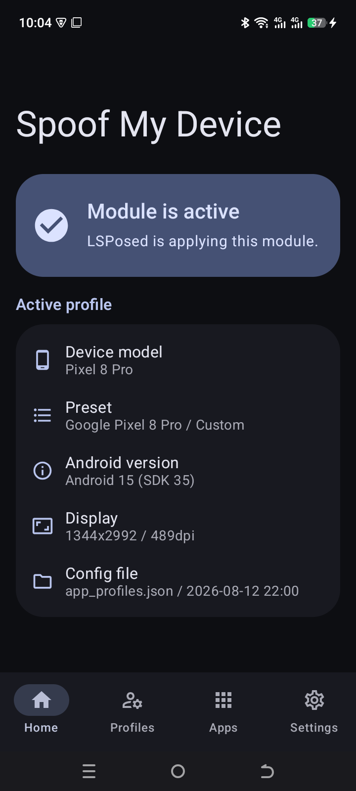
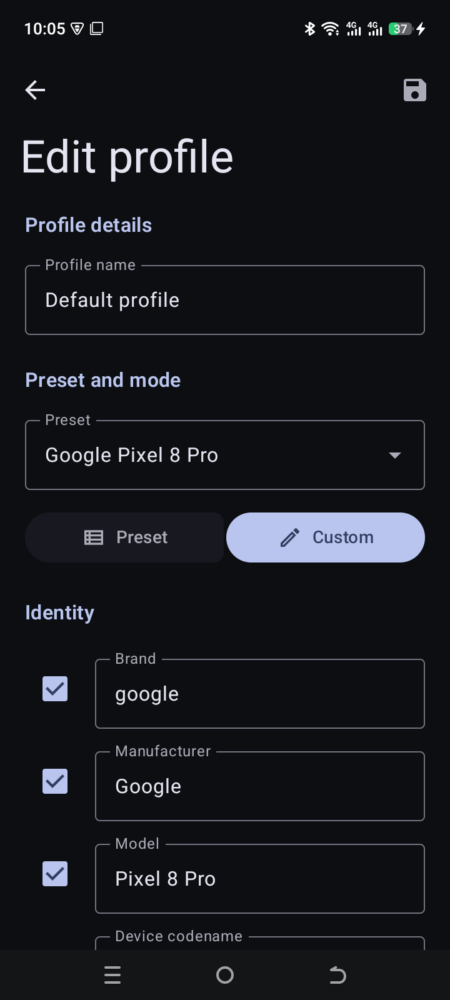
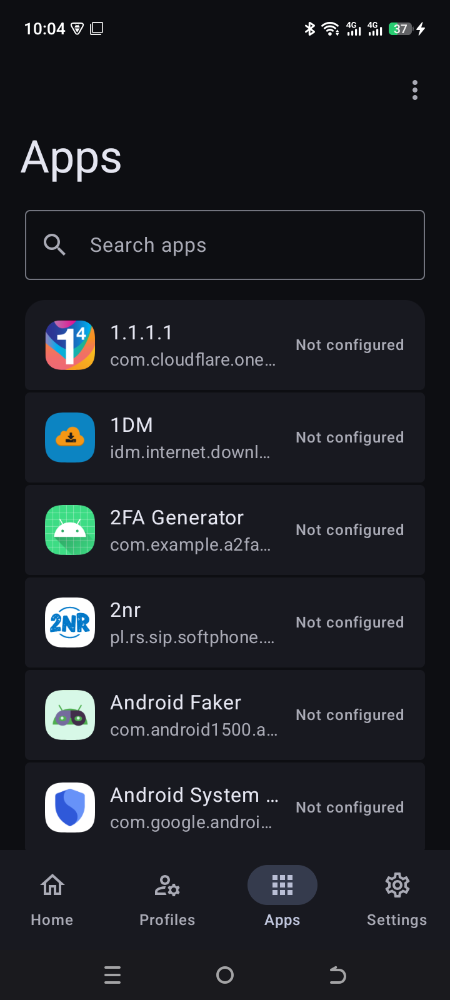

<div align="center">

# SpoofMyDevice

### Per-app Android device identity, on your own terms

Give each app its own device. Build reusable profiles — brand, model, fingerprint,
telephony, display, locale — and assign a different one to every app on your phone.

[](https://github.com/SomawDev/SpoofMyDevice/releases/latest)
[](https://github.com/SomawDev/SpoofMyDevice/releases)
[](#requirements)
[](#rooted-lsposed-setup)
[](LICENSE)

[**Download**](https://github.com/SomawDev/SpoofMyDevice/releases/latest) ·
[Setup](#rooted-lsposed-setup) ·
[Safe Mode](#safe-mode) ·
[How it works](#how-it-works) ·
[Build](#build-from-source)

<br>





</div>

---

## Why

Most spoofing modules apply one identity to the whole device. SpoofMyDevice keeps a
library of profiles and assigns them **per app**, so one app can see a Pixel 8 Pro while
another sees the real hardware and a third sees something you made up field by field.

## Features

|  | |
|---|---|
| **Profiles** | Reusable presets or fully custom values, saved and reassignable |
| **Per-app assignment** | Every app gets its own profile; unassigned apps are never hooked |
| **Live propagation** | Changes reach already-running hooked apps without a reboot |
| **Per-field control** | Enable individual fields and randomize advanced identifiers in one tap |
| **Safe Mode** | Keeps the real Android version to prevent version-mismatch crashes |
| **Broad coverage** | Model, fingerprint, telephony, display, locale, timezone, Build ID |
| **Localized** | English, Korean, Japanese, Simplified Chinese |
| **Both workflows** | Rooted LSPosed, or non-root via LSPatch / NPatch |

The Android System Framework is always excluded from hooking, regardless of settings.

## Requirements

- **Android 8.0** or newer
- A module runtime, either:
  - **LSPosed** on a rooted device, or
  - a non-root patch manager implementing the legacy Xposed API (**LSPatch**, **NPatch**)

## Rooted LSPosed Setup

```
1. Install the APK and open it once
2. Enable SpoofMyDevice in LSPosed
3. Add only your target apps to the module scope   ← not Android System Framework
4. Profiles → create a profile → pick a preset or edit values → save
5. Apps → pick a target app → assign the profile
6. Force stop and relaunch the app
```

The Home screen shows **Module is active** once LSPosed is applying the module.

## Non-root Setup

```
1. Install the APK normally and open it once
2. In LSPatch / NPatch, register SpoofMyDevice as the Xposed module for the target APK
3. Patch the target APK and install the result
4. Profiles → create and save a profile
5. Apps → select the patched app → assign the profile
6. Relaunch the patched app
```

> [!WARNING]
> Patched APKs are re-signed, so their signature differs from the original. Apps that
> enforce signature, installer, or integrity checks may reject a patched build, and an
> official update will replace it.

## Safe Mode

Safe Mode prevents crashes when a profile reports a **newer Android version than the
physical device**. For the apps you select, it passes through only:

- `Build.VERSION` fields
- `ro.*.build.version.*` properties

Everything else — model, fingerprint, network, telephony, identifiers — still spoofs
normally.

## How It Works

Profiles, assignments, and global options live in a single app-private
`app_profiles.json`. An exported config provider returns **only** the profile assigned to
the requesting package, so an app can never read another app's configuration, and
packages without an assignment are not hooked at all.

Saving a profile broadcasts a config-change event, letting already-hooked processes
reload in place. A newly assigned app still needs a relaunch, because Xposed installs
hooks when a process starts. Some apps also cache identifiers internally and need a force
stop.

## Build From Source

```bash
git clone https://github.com/SomawDev/SpoofMyDevice.git
cd SpoofMyDevice
./gradlew assembleRelease
```

| Variant | Command | Use for |
|---|---|---|
| `release` | `./gradlew assembleRelease` | Distribution — minified, shrunk, signed |
| `benchmark` | `./gradlew installBenchmark` | Measuring performance (release build, debug-signed) |
| `debug` | `./gradlew assembleDebug` | Development only |

> [!CAUTION]
> Don't distribute the debug build. It is `debuggable`, so any process can attach a
> debugger and read your private profile data, and it runs unoptimized — a poor guide to
> real performance. Judge smoothness with `benchmark`, never `debug`.

### Signing

Release signing reads `keystore.properties` from the repository root. It is gitignored
and must never be committed:

```properties
storeFile=C:/path/to/spoofmydevice-release.jks
storePassword=...
keyAlias=spoofmydevice
keyPassword=...
```

CI can supply `ANDROID_KEYSTORE_FILE`, `ANDROID_KEYSTORE_PASSWORD`, `ANDROID_KEY_ALIAS`,
and `ANDROID_KEY_PASSWORD` instead. With neither configured the release build still
assembles, just unsigned.

> [!IMPORTANT]
> Back up the keystore **and** its password somewhere durable. Android identifies an app
> by its signing certificate — lose either and no future version can ever install as an
> update over an existing one.

## Tech

Jetpack Compose throughout, Material 3 Expressive components, Tonal Spot palette, and the
2025 Material color specification. Release builds are R8-minified with baseline profiles
applied at install.

## Disclaimer

Intended for research, testing, and authorized use. Follow applicable laws, platform
rules, and the policies of the apps being tested.

## License

[MIT](LICENSE)
